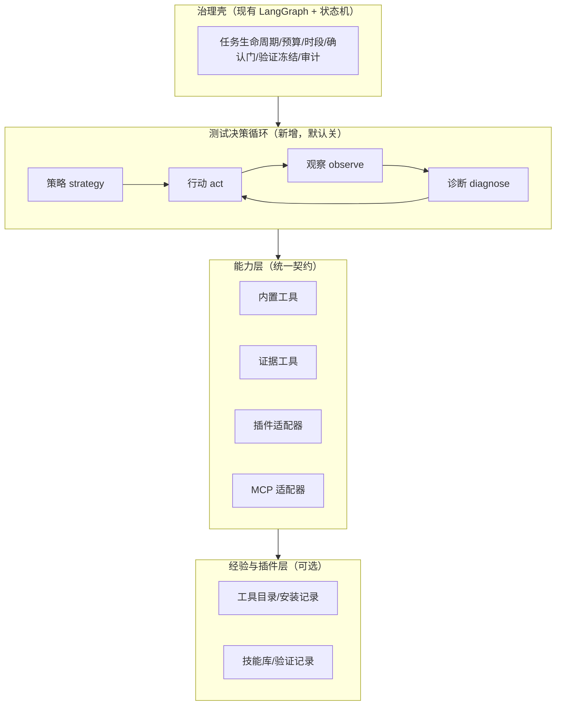
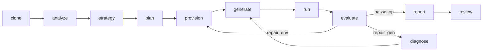

# 《随llm进化可迭代可进化test系统》

> 副标题：面向模型能力增长的测试 Agent 演进设计  
> 版本：v1.0（设计稿）  
> 日期：2026-11-20  
> 状态：待拍板，未实施  
> 范围：设计、文件级改造清单、权限边界、验收与实验方案  
> 非目标：本文不授权修改代码、安装插件、调整生产配置或跑付费实验

---

## 0. 一句话方案

把现在的“固定流水线里的 LLM 助手”升级为**有界自主的测试 Agent**：

> 模型获得测试策略、工具组合和脚本适配的决策权；  
> 平台保留判据、证据、权限、版本推广和最终放行的治理权。

模型能力提升时，系统能通过**更强的观察、更合理的策略、更准确的脚本适配**获得收益；但不会因为模型变强而自动获得修改产品、放宽断言或安装任意代码的权力。

---

## 1. 结论先行

### 1.1 三个判断

**判断一：方向成立，但“提高权限”不是正确表述。**

更强的模型要转化为更强的测试能力，需要三件事同时成立：

1. **决策空间可扩展**：测试路线、顺序、工具组合不能全部写死。
2. **工具体系可插拔**：新能力可以通过契约接入，而不是每次改平台代码。
3. **经验可验证沉淀**：成功的适配过程能变成可复用、可验证的技能。

这三件事都不要求把宿主机的文件、网络、密钥或全局工具链权限直接交给模型。

**判断二：测试系统的核心风险不是“模型不会做”，而是“模型太容易把失败做成通过”。**

因此必须把两类权力分开：

| 权力 | 归属 | 原因 |
|---|---|---|
| 怎么测、先测什么、用什么工具、如何适配脚本 | 模型（在预算和能力清单内） | 这是模型能力增长最能发挥的地方 |
| 什么算通过、证据是否充分、验证用例是否冻结、工具能否全局推广 | 平台/人 | 这是测试可信度的底线，不能交给被测方或修复方自证 |

**判断三：不需要推翻 LangGraph，也不需要换掉现有六语言执行链。**

现有图、状态机、容器执行、结果适配器、覆盖率、缺陷归因、两阶段审查都可以保留。改动集中在：

- 在 `analyze` 与 `plan` 之间增加可选的**策略决策节点**；
- 在 `evaluate` 的 `repair_*` 分支增加可选的**证据诊断节点**；
- 把现有 `Skill` 注册表升级为**统一能力层**；
- 新增**插件目录与生命周期**、**经验库**两个可选层。

所有新能力默认关闭；关闭时旧行为逐字节不变。

### 1.2 五条设计原则

| 原则 | 含义 | 直接约束 |
|---|---|---|
| P1 判据真值不外包 | 产品预期、断言基准、验证结论不能由被测/修复方自行修改 | 验证任务冻结；断言变更必须走新版本与审查 |
| P2 证据先于结论 | 任何“通过/失败/已修复”必须来自真实执行和可信解析 | 模型自然语言不能写终态；插件不能自报通过 |
| P3 硬约束确定性执行 | 权限、预算、镜像、网络、冻结状态由代码判定 | 不依赖提示词“请勿越权” |
| P4 版本固定、可回放、可回滚 | 模型、工具、技能、项目快照都固定版本 | 运行中不静默升级；升级可回退 |
| P5 先 MVP 后市场 | 先用现有工具跑通自主循环，再做插件与经验库 | 不先建插件市场，不先做自动更新器 |

---

## 2. 问题定义

### 2.1 为什么“换更强模型”不一定带来更强测试

当前系统的能力上限不在模型本身，而在三个结构性限制：

**（1）策略上限**

测试路线由固定规则和固定优先级决定，需求语义没有参与路线选择；完整执行项目甚至不进入路线编排。模型再强，也只能在既有分支内生成用例。

**（2）工具上限**

模型不能根据项目情况主动调用“读依赖、探测环境、跑子集、看覆盖缺口、做差分”等工具，也不能在观察到结果后改变下一步。所谓“生成→失败→重生成”仍是固定回炉，不是自主诊断。

**（3）经验上限**

一次成功的框架适配、目录适配、启动方式适配，停留在本次任务的提示词和脚本里，没有变成下一次可检索、可验证、可复用的技能。

### 2.2 测试系统特有的四个风险

| 风险 | 表现 | 本设计的对策 |
|---|---|---|
| 自证陷阱 | 修复测试的模型同时判断“已修复” | 验证结论由平台和执行证据给出，修复方无终态权 |
| 断言迁就 | 为了让用例通过，改预期值、删失败用例、跳过缺陷 | 断言变更与脚手架修复分离；验证任务冻结；变更留痕 |
| 假绿 | 用例没执行、被 mock 掉、被跳过，报告却显示通过 | 执行可达性、原始结果、证据文件强制校验 |
| 供应链 | 自动下载的插件带恶意代码或破坏环境 | 目录准入、摘要固定、沙箱安装、契约验证、人工推广 |

---

## 3. 现状核查（代码证据）

### 3.1 已具备的零件

| 已有零件 | 代码位置 | 能做什么 | 当前不能做什么 |
|---|---|---|---|
| 路线注册表 | `test_agent/skills/routes.py:152` | 声明 11 条路线、前置条件、优先级、工具链、oracle 类型 | 不使用需求语义；只做筛选和排序，不做统一调度 |
| 路线编排 | `test_agent/skills/routes.py:233` | 生成候选路线与选/不选理由，落 `route_plan` 表 | 主图只消费 UI 交互幂等一条；完整执行项目不进入 |
| Skill 注册 | `test_agent/skills/registry.py:54` | 元数据 upsert、审计表、确认门 | 版本固定 `1.0.0`；不动态加载实现 |
| Skill 调用 | `test_agent/skills/registry.py:70` | `confirmed` 确认门、线程池、超时记录、审计 | 不校验参数 Schema、不检查 `enabled`、不执行风险分级；超时只停止等待 |
| 内置工具 | `test_agent/skills/builtin.py:110` | 安装依赖、跑测试、生成用例、DB/UI/gRPC 断言 | 固定闭包；没有插件发现、没有能力缺口申请 |
| 模型客户端 | `test_agent/skills/llm_client.py:130` | 重试、402 降级、记账 | 没有工具调用循环；`__getattr__` 直接绑定会绕过包装层 |
| 任务状态 | `test_agent/graph/state.py:8` | 跨节点字段（含 `verify_mode`） | 没有策略、证据、预算、授权字段 |
| 环境 recipe | `test_agent/skills/recipe.py:34` | 镜像池、安装白名单、Dockerfile 拼装 | 语言枚举只有 python/javascript/go；模型不能扩展目录 |
| 经验资产 | trapkb / alias / seed | 历史失败提示、别名候选、结构样板 | 都不注册为可执行技能 |

### 3.2 关键缺口

| 编号 | 缺口 | 证据 | 影响 |
|---|---|---|---|
| G1 | 没有策略决策 | `routes.py:233` 固定优先级排序；`nodes.py:1037` 仅非 full 项目进入；`nodes.py:1047-1049` 的 `l4` 误用 L3 开关 | 更强模型无法选择“先测什么、为什么” |
| G2 | 没有工具循环 | 主图为固定节点：`builder.py:33`、`builder.py:58-61` | 模型不能观察→调用→再决策 |
| G3 | 没有执行授权层 | `registry.py:70-98` 只做确认门和超时 | 开放模型调用后，参数、路径、风险都无统一闸 |
| G4 | 没有插件生命周期 | `builtin.py:110` 固定工具；`config.py:288-304` 固定安装白名单 | 新工具只能改代码接入 |
| G5 | 没有经验沉淀 | 成功适配停留在任务产物 | 同类项目重复踩坑 |
| G6 | 前置完整性缺口 | 验证资产可变、空审查可收敛、取消竞态、凭据绑定、索引失效（详见 `docs/设计方案-文件级修复与验收设计-20261120.md`） | 自主权放大后，这些缺口会被放大 |

### 3.3 结论

当前系统是**“固定工作流内的 LLM 决策”**，不是自主测试 Agent。

它已经有很好的“零件”：路线、工具、审计、容器、适配器、影子知识库。缺的是把零件接成**可治理的决策循环**。

---

## 4. 外部机制考察与取舍

| 机制 | 可借鉴 | 不能直接照搬 | 对本项目的用法 |
|---|---|---|---|
| **Playwright Test Agents** | planner 探索并出计划；generator 生成并实时验证；healer 依据运行结果修复 | healer 文档允许“认为功能损坏时跳过测试”；这会把缺陷藏起来 | 借鉴观察→行动→修复循环；保留“真实失败必须是缺陷证人”的纪律 |
| **MCP** | 工具发现、参数描述、调用、结果返回、工具列表变化通知 | 协议不负责安装、验签、信任和权限；连上不等于安全 | 作为外部工具接入口，不作为信任来源 |
| **Agent Skills** | `SKILL.md` + 脚本 + 资源；渐进披露；按需加载 | Skill 不是模型训练；脚本仍需沙箱、资源和审计 | 作为经验库格式参考；脚本执行走统一能力层 |
| **OpenHands SDK** | 类型化 Action/Observation/Executor；工作区隔离；安全分析与确认策略 | LLM 自报风险等级只是建议，不能替代宿主策略 | 借鉴契约和确认分层；执行边界由平台代码判定 |
| **Voyager** | 可执行技能库、检索、组合、环境反馈、自验证 | 领域是 Minecraft；自验证是 LLM 评论，不是确定性证明 | 借鉴“经验积累+验证后复用”，不借鉴“模型自评即正确” |

**考察结论：**

目前没有现成的“让模型自动下载任意工具并安全替换全局工具链”的通用机制可以直接搬。最接近的成熟做法都是**受控扩展**：

> 批准目录 + 固定版本/摘要 + 隔离执行 + 契约验证 + 人工推广 + 可回滚。

因此本设计不追求“模型自治的软件供应链”，而是“平台治理下的可扩展能力”。

---

## 5. 目标架构

### 5.1 四层结构



**关键点：**

- 治理壳仍然是唯一能改任务终态、放行阶段二、判定验证结果、推广全局工具的层。
- 决策循环只能在治理壳给出的预算、能力清单和任务模式内行动。
- 能力层是唯一执行入口；模型不能绕过它直接起容器或跑宿主命令。
- 经验与插件层默认关闭；开启后也必须经过目录、验证和推广流程。

### 5.2 图改动



- `strategy`（可选）：在 `plan` 前生成测试策略，决定能力组合、预算分配、证据计划。
- `diagnose`（可选）：在 `repair_gen` 前做小步证据诊断，区分脚手架、环境、产品缺陷和预期争议。
- 两个节点都由开关控制；关闭时图与现在完全一致。
- **不新增“模型自由选择下一节点”的能力**；节点顺序仍由平台决定，模型只在节点内部做有限决策。

### 5.3 新增状态字段

以下字段必须写入 `test_agent/graph/state.py` 的 `TaskState`。项目已多次实锤：未声明键会被 LangGraph schema 过滤，导致静默死代码。

| 字段 | 类型 | 用途 | 写入方 |
|---|---|---|---|
| `agent_loop_enabled` | `bool` | 本任务是否启用决策循环 | builder 初始化 |
| `agent_strategy` | `dict` | 能力组合、优先级、预算、证据计划、回退方案 | `strategy` 节点 |
| `agent_steps` | `int` | 已用决策步数 | `tool_loop` |
| `agent_budget` | `dict` | `max_steps/max_tokens/max_seconds/used_*` | `strategy`/`tool_loop` |
| `agent_evidence` | `list[dict]` | 证据引用（调用 id、类型、路径、摘要），不存原始大文本 | 能力执行器 |
| `agent_diagnosis` | `dict` | 原因分类、证据引用、建议动作、置信度 | `diagnose` 节点 |
| `agent_capability_grants` | `list[str]` | 本任务获批的能力/权限范围 | 平台策略层 |
| `agent_plugin_requests` | `list[dict]` | 能力缺口申请（只申请，不安装） | `tool_loop` |
| `agent_loop_stop` | `str` | `goal_met/budget/no_new_evidence/repeated_action/hard_error` | `tool_loop` |

### 5.4 与现有机制的关系

| 现有机制 | 新设计中的位置 | 关系 |
|---|---|---|
| 项目索引 / 模块路由 | 策略节点的输入 | 继续作为定位依据；模型可根据漏测证据申请扩圈 |
| L1/L2/L3 辅助急救 | 能力层的已有能力 | 保留；由策略决定何时调用 |
| R-Loop `repair_env/repair_gen` | `diagnose` 的下游 | 诊断只提供证据和建议，不直接改 `verdict` |
| 两阶段审查 / AI 代审 | 治理壳 | 继续负责放行与审查；自主循环不能绕过 |
| 验证冻结 `verify_mode` | 治理壳硬约束 | 自主循环在验证任务中只读 |
| 环境 recipe | 能力层的环境能力 | 保留白名单；插件不能自造镜像 |

---

## 6. 核心契约

### 6.1 Capability：统一能力描述

每个工具（内置、插件、MCP）都必须用同一份描述注册。模型看到的是能力菜单，不是散落的 Python 函数。

```json
{
  "id": "test.run.pytest",
  "version": "1.4.0",
  "kind": "execute",
  "languages": ["python"],
  "description": "在任务沙箱内运行指定 pytest 目标，返回结构化结果与证据文件",
  "inputs_schema": {
    "type": "object",
    "properties": {
      "targets": {"type": "array", "items": {"type": "string"}},
      "timeout_s": {"type": "integer", "minimum": 1, "maximum": 600}
    },
    "required": ["targets"],
    "additionalProperties": false
  },
  "outputs_schema": {
    "type": "object",
    "properties": {
      "status": {"enum": ["ok", "failed", "timeout", "denied", "unsupported"]},
      "metrics": {"type": "object"},
      "evidence": {"type": "array"}
    }
  },
  "evidence": ["junit_xml", "stdout", "stderr", "exit_code"],
  "permissions": {
    "fs": ["test_artifacts_write"],
    "network": "none",
    "secrets": []
  },
  "risk": "R1",
  "timeout_s": 300,
  "cancellable": true,
  "compat": {"images": ["mta-test:py312"]},
  "source": {"type": "builtin", "digest": "sha256:..."}
}
```

**字段规则：**

| 字段 | 必填 | 说明 |
|---|---|---|
| `id` | 是 | 稳定标识，版本升级不改 id |
| `version` | 是 | 语义版本；任务运行中固定 |
| `kind` | 是 | `observe/execute/analyze/edit/install` |
| `inputs_schema` | 是 | 标准 JSON Schema；执行前强制校验 |
| `outputs_schema` | 是 | 结果结构；平台校验后再交给模型 |
| `evidence` | 是 | 必须产出的证据类型；缺失则结果降级为 `unsupported` |
| `permissions` | 是 | 文件、网络、密钥范围 |
| `risk` | 是 | R0–R4，见 6.3 |
| `cancellable` | 是 | 超时能否真正终止执行 |
| `compat` | 是 | 适用镜像/语言/版本 |
| `source` | 是 | 内置/插件/MCP；含摘要 |

### 6.2 Action / Result：调用与返回契约

模型只能输出以下两种动作之一：

```json
{
  "action": "call",
  "capability": "test.observe.coverage",
  "args": {"target": "src/"},
  "reason": "当前覆盖缺口集中在支付模块，先确认缺口行",
  "expected_evidence": ["coverage_json"]
}
```

```json
{
  "action": "finish",
  "summary": "已完成策略内可用能力，剩余缺口见证据",
  "evidence_refs": ["inv-1024", "inv-1027"]
}
```

能力返回统一结构：

```json
{
  "status": "ok",
  "summary": "pytest 执行完成：3 过 1 败",
  "metrics": {"passed": 3, "failed": 1, "skipped": 0},
  "evidence": [
    {"kind": "junit_xml", "path": "artifacts/task-123/junit.xml", "sha256": "..."},
    {"kind": "stdout", "path": "artifacts/task-123/stdout.txt", "sha256": "..."}
  ],
  "diagnostics": [
    {"code": "ENV_MISSING_DB", "message": "连接 127.0.0.1:5432 被拒绝"}
  ],
  "raw_exit": 1
}
```

**铁律：**

1. `status` 是**执行状态**，不是测试结论。
2. 测试通过/失败由现有语言适配器和解析器判定，模型不能写 `verdict`。
3. `evidence` 必须是任务产物目录下的真实文件；报告页可追溯。
4. 无法产出规定证据时，返回 `unsupported`，不能伪装成 `ok`。
5. 模型自然语言总结不能覆盖 `metrics` 和 `raw_exit`。

### 6.3 权限模型

#### 风险等级

| 等级 | 名称 | 示例 | 默认策略 |
|---|---|---|---|
| R0 | 观察/只读 | 读文件、列目录、搜索、环境探测、跑只读测试、看覆盖率 | 任务预算内自动 |
| R1 | 测试产物写 | 改导入/路径/夹具/选择器/等待、写测试辅助文件、生成用例 | 任务预算内自动，但必须留 diff 与证据 |
| R2 | 沙箱依赖安装 | 安装目录内、固定版本、已批准摘要的测试依赖 | 仅“目录内+摘要匹配+任务级”自动；其他需批准 |
| R3 | 新插件/新网络/新凭据 | 新来源插件、MCP 服务器、外部网络、密钥范围 | 必须人工/管理员批准 |
| R4 | 全局推广/策略变更 | 替换全局工具版本、修改验证规则、修改安全策略 | Agent 永远无权；管理员+验证流水线 |

#### 任务模式矩阵

| 任务模式 | R0 | R1 | R2 | R3 | R4 |
|---|---|---|---|---|---|
| `normal` 普通测试 | 自动 | 自动 | 仅目录内自动 | 批准 | 禁止 |
| `verify` 验证修复 | 自动（只读执行） | 禁止 | 禁止 | 禁止 | 禁止 |
| `static` 静态模式 | 自动 | 禁止 | 禁止 | 禁止 | 禁止 |

#### 硬约束与软启发式

这是本设计最重要的一条区分：

| 类型 | 例子 | 谁能覆盖 | 处理方式 |
|---|---|---|---|
| **硬约束** | 语言/镜像不兼容、权限不足、预算耗尽、验证冻结、网络范围、插件摘要不匹配 | 平台 | 直接拒绝；模型可申请，但不能绕过 |
| **软启发式** | “没匹配到 FastAPI 关键词”“没有 requirements.txt”“固定路线优先级” | 模型可用探测证据申请覆盖 | 平台记录理由，允许重新评估 |

**目的：** 更强的模型不应被一条粗糙正则永久挡住；但它也不能用“我觉得可以”绕过真实的环境和权限限制。

### 6.4 决策循环

```python
for step in range(budget.max_steps):
    observation = build_observation(task_ctx, evidence, last_result)
    action = llm_decide(observation, capability_menu, budget, stop_conditions)

    decision = policy.authorize(action, task_ctx)
    if decision.denied:
        record_denial(action, decision.reason)
        evidence.append({"kind": "denied", "reason": decision.reason})
        continue

    result = executor.run(action, task_ctx)
    evidence.append(normalize(result))

    if goal_met(evidence) or no_new_evidence_twice(evidence):
        break
```

**停止条件：**

| 条件 | 行为 |
|---|---|
| 目标达成且有证据 | 正常结束，交回外层图 |
| Token/时间/步数预算耗尽 | 停止，保留已有证据，如实报告缺口 |
| 连续两次没有新证据 | 停止，避免空转 |
| 同一动作指纹重复超过阈值 | 停止，记录 `repeated_action` |
| 硬错误（容器不可用、权限拒绝、镜像缺失） | 停止对应分支，按现有 `repair_env` 或 `stop` 处理 |

**防死循环：**

- 动作指纹 = `capability + canonical_json(args)`；
- 每个任务有 `max_steps`（建议 8）和 `max_tokens` 上限；
- 诊断分支更小（建议 3 步）；
- 模型不能自行提高预算。

### 6.5 脚手架修复 vs 断言变更

这是测试 Agent 与通用编程 Agent 最大的区别。

| 变更类型 | 是否允许 | 条件 |
|---|---|---|
| 改 import、模块路径、包布局适配 | 允许 | R1；diff 留痕；重新执行 |
| 改测试夹具、启动方式、序列化、等待 | 允许 | R1；不得改变业务预期 |
| 改选择器、页面定位、接口字段名（被测项目确实变了） | 允许 | R1；必须有项目证据；保留旧版本 |
| 改断言预期值 | 禁止自动 | 必须新建测试版本，进入审查 |
| 删除/跳过失败用例 | 禁止自动 | 只能隔离并标注原因，报告中可见 |
| 修改被测产品代码 | 禁止 | 测试 Agent 永远不改 SUT |
| 修改原始需求 | 禁止 | 新需求 = 新任务或新版本 |
| 验证任务中修改任何测试资产 | 禁止 | `verify_mode=1` 硬拦截 |

**执行方式：**

- 新增能力 `test.edit.scaffold`，只允许写测试产物目录；
- 平台对 diff 做确定性分类：断言/预期变更 → 拒绝；导入/路径/夹具变更 → 允许；
- 被拒绝的断言变更生成 `oracle_change_request`，由人审查后创建新测试版本；
- 所有变更保留旧文件、diff 和原因，报告页可追溯。

### 6.6 结果口径

1. 所有语言结果继续走现有适配器（pytest/jest/junit/phpunit/go test/playwright 等），统一成 `test_case_results` 与评估输入。
2. 插件的原生输出必须由适配器转换；不能直接把插件 stdout 当作平台结论。
3. 覆盖率、通过数、失败数、跳过数必须来自解析器，不能来自模型摘要。
4. 不支持的能力明确 `unsupported`；不允许“估一个覆盖率”或“算全部通过”。

---

## 7. 插件槽位与生命周期

### 7.1 工具目录

新增批准目录 `data/tool_catalog/catalog.json`（后续可入库）。示例：

```json
{
  "schema_version": 1,
  "tools": [
    {
      "id": "test.coverage.py",
      "version": "1.2.0",
      "kind": "plugin",
      "source": {
        "type": "pypi",
        "name": "coverage",
        "url": "https://pypi.org/project/coverage/"
      },
      "digest": "sha256:....",
      "license": "Apache-2.0",
      "languages": ["python"],
      "entrypoint": "coverage_plugin:register",
      "permissions": {
        "fs": ["test_artifacts_write"],
        "network": "none",
        "secrets": []
      },
      "fixtures": ["happy_path", "known_bad", "timeout"],
      "status": "verified"
    }
  ]
}
```

**目录准入规则：**

- 只允许固定版本和摘要；不接受 `latest`。
- 来源必须是批准域名/包管理器。
- 必须声明许可证、入口、权限、适用语言/镜像。
- 必须有正常样例和已知缺陷样例。
- `status` 只能是 `candidate/verified/active/deprecated/revoked`。

### 7.2 七步生命周期

| 步骤 | 触发 | 执行者 | 产物 | 失败处理 |
|---|---|---|---|---|
| 1 发现缺口 | 模型发现现有能力不足 | 模型 | `plugin_request`（只描述需求与证据） | 记录缺口，不安装 |
| 2 解析目录 | 平台收到申请 | 平台 | 匹配目录条目/固定版本 | 无匹配 → 只生成提案 |
| 3 审批 | R3 操作 | 人/管理员 | 批准/拒绝记录 | 拒绝 → 模型换策略 |
| 4 沙箱安装 | 批准后 | 隔离执行器 | `tool_installations` 行 | 失败 → 回滚 |
| 5 契约验证 | 安装后 | 平台 | 正常/坏例/超时/无网络报告 | 失败 → 禁用 |
| 6 任务启用 | 验证通过 | 平台 | 任务级 grant | 过期自动回收 |
| 7 推广/回滚 | 多次成功+人工 | 管理员 | 目录状态变更 | 新版本并存，可回退 |

### 7.3 隔离要求

1. **禁止把下载代码 import 进 FastAPI 主进程。**
2. 插件只在任务沙箱或专用工具容器中执行。
3. 默认无外网；需要网络的插件必须单独授权并限定域名。
4. 被测项目只读挂载；测试产物目录可写；临时目录可写。
5. 资源限制：CPU、内存、墙钟、输出大小。
6. 插件说明、README、仓库文档、工具输出都视为**不可信数据**，不能作为权限提升依据。
7. 摘要匹配只证明“内容与目录一致”，不证明“代码安全”；仍需契约验证和权限隔离。

### 7.4 MCP 适配

- MCP 作为**外部工具接入协议**，不是安装器、不是信任源。
- Phase 2 先做本地目录 + 插件适配；MCP 适配器放到 Phase 2 后半或 Phase 3。
- MCP 工具默认按 R3 处理；首次使用需批准。
- MCP 的 `list_changed` 只能触发“重新发现”，不能自动启用新工具。
- MCP 返回的注解、描述、输出都不能直接成为平台策略。

### 7.5 版本策略

| 规则 | 说明 |
|---|---|
| 任务内固定 | 一个任务从开始到结束使用同一工具版本 |
| 并存升级 | 新版本与旧版本同时存在，不覆盖 |
| 小范围试用 | 新版本先跑固定样例和少量任务 |
| 可回滚 | 任何推广都保留旧版本和回退路径 |
| 不追最新 | “最新”不是准入理由；兼容性和契约验证才是 |

---

## 8. 经验库（Skill）

### 8.1 技能格式

建议兼容 Agent Skills 的思路，但由平台自己解析和验证。示例：

```markdown
---
name: fastapi-testclient-harness
version: 1.0.0
applies_to:
  language: python
  framework: fastapi
  version: ">=0.100,<1.0"
preconditions:
  - file: requirements.txt contains fastapi
  - file: no existing conftest.py conflict
tools:
  - test.run.pytest
  - test.edit.scaffold
evidence:
  - junit_xml
  - coverage_json
validation:
  projects: [coupon-api, task-1981]
  result: "3/3 通过，零误报增加"
---
## 步骤
1. 读取应用入口，确认 ASGI app 对象。
2. 使用 TestClient，不启动真实端口。
3. 为数据库依赖注入隔离夹具。
4. 运行最小冒烟，再扩展场景。

## 已知失败模式
- requirements 漏 httpx：先补装再收集。
- 应用启动时连真实 DB：改用依赖覆盖，不改产品代码。
```

### 8.2 生命周期

| 状态 | 进入条件 | 退出条件 |
|---|---|---|
| `candidate` | 从一次成功适配的任务轨迹中抽取 | 通过至少一个 held-out 项目验证 |
| `validated` | 正常样例通过，且未增加误报 | 人工审查 |
| `active` | 人工批准，版本固定 | 出现回归或被新版本替代 |
| `deprecated` | 新版本/新框架替代 | 保留只读记录 |
| `revoked` | 发现错误引导或安全问题 | 立即停用 |

**关键规则：**

- 一次成功不能直接成为全局技能。
- 技能必须记录适用版本范围；超出范围不自动套用。
- 技能不能包含“为了让测试通过而放宽断言”的步骤。
- 技能中的脚本与插件同等对待：沙箱执行、权限校验、证据留痕。

### 8.3 检索

- 初期按**标签/能力/语言/框架/版本**过滤，不做向量检索。
- 项目此前已明确不引入 embedding 语义检索（不可审计）；本设计不改变该决定。
- 技能描述进入提示词时只放摘要（渐进披露），完整步骤按需加载。
- 检索结果必须带来源、版本、验证记录。

### 8.4 失败经验

经验库不只存“成功配方”，还要存**反模式**：

- 不要 mock 被测模块本身；
- 不要用 `assert True` 或宽泛异常吞掉失败；
- 不要在验证任务中重建用例；
- 不要用“跳过”处理真实缺陷；
- 不要把环境错误归因为产品缺陷。

反模式同样需要来源、证据和适用范围，不能凭模型自述入库。

### 8.5 与现有资产的关系

| 现有资产 | 关系 |
|---|---|
| `trapkb_v2` | 作为技能/提示的失败模式来源之一 |
| 别名候选 `suggest_aliases` | 继续人工审核入表；不自动变成执行能力 |
| 种子模板 | 作为“结构样板”经验；验证后可进入技能库 |
| 失败语料 | 作为技能验证的负例来源 |

---

## 9. 分阶段实施

### 9.1 阶段 0：前置加固（必须先做）

自主权会放大现有完整性缺口。以下项目必须在开放决策循环前完成，具体设计见 `docs/设计方案-文件级修复与验收设计-20261120.md`。

| 项 | 为什么必须先做 | 验收 |
|---|---|---|
| 验证资产不可变清单 | 否则自主编辑可以改判据 | 创建时快照覆盖用例/脚本/资产；验证任务只认原始成员全部执行且通过 |
| 空审查不得收敛 | 否则空工作会被自动放行 | 零用例/全无效决策 → `fail_closed` |
| 队列与任务状态原子化 | 否则取消后可能复活/重复执行 | CAS + `cancelled` 守卫 + 终态一致 |
| 注册表执行闸 | 否则模型可传任意参数/路径 | Schema、`enabled`、风险、路径范围全部校验 |
| 可取消执行 | 否则超时只停止等待，进程仍在跑 | 超时能终止进程/容器；有测试 |
| 凭据-端点绑定 | 否则 key 可被配到任意端点 | 绑定校验；任务级密钥范围 |
| 索引失效完整 | 否则改 spec/manifest 不重建 | spec/go.mod/清单变化触发重建 |

**阶段 0 产出：** 无新功能，只有可信度。此阶段完成前，不建议开启 `MTA_AGENT_LOOP` 的真实任务。

### 9.2 阶段 1：自主决策 MVP（只用现有工具）

**目标：** 不安装任何新插件，只让模型在现有能力清单内做策略和诊断，验证“更强模型是否能带来更好的测试决策”。

#### 新增文件

| 文件 | 职责 | 预估 |
|---|---|---|
| `test_agent/skills/capabilities.py` | Capability 描述、目录加载、能力菜单、参数/结果校验 | ~250 行 |
| `test_agent/skills/tool_policy.py` | 统一授权：风险、路径、网络、密钥、预算、冻结 | ~220 行 |
| `test_agent/skills/tool_loop.py` | 有界决策循环、动作指纹、停止条件、证据收集 | ~260 行 |
| `test_agent/graph/agent_nodes.py` | `strategy` 与 `diagnose` 节点 | ~220 行 |
| `tests/test_capabilities.py` | 描述/菜单/Schema 校验 | ~150 行 |
| `tests/test_tool_policy.py` | 权限矩阵、拒绝路径、冻结 | ~180 行 |
| `tests/test_tool_loop.py` | 步数、预算、重复动作、证据 | ~180 行 |

#### 修改文件

| 文件 | 改动 |
|---|---|
| `test_agent/graph/state.py` | 增加 5.3 的 9 个字段 |
| `test_agent/graph/builder.py` | 增加 `strategy`、`diagnose` 节点与条件边；开关关闭时图不变 |
| `test_agent/graph/nodes.py` | 构造能力菜单；`strategy` 调用模型；`diagnose` 只读取证 |
| `test_agent/skills/routes.py` | 增加 `route_candidates()`：硬前置与软启发式分离；修复 `l4` 误用 L3 开关 |
| `test_agent/skills/registry.py` | `invoke` 增加 Schema/`enabled`/风险/路径校验；输出证据引用；超时取消 |
| `test_agent/skills/llm_client.py` | 增加 `bind_tools_preserving_wrapper()`，保证重试/降级/记账不被绕过 |
| `test_agent/config.py` | `MTA_AGENT_LOOP`（默认关）、步数/Token/时间预算 |
| `test_agent/skills/prompt_library.py` | 策略/诊断提示词：能力菜单、硬约束、证据要求 |
| `scripts/eval_metrics.py` | 增加策略有效性、步数、拒绝次数、证据完整度计数 |

#### MVP 能力清单

| 能力 | 风险 | 用途 |
|---|---|---|
| `test.observe.read` | R0 | 读文件/列目录/搜索 |
| `test.observe.env` | R0 | 依赖、解释器、服务端口探测 |
| `test.run.unit` | R0 | 运行指定测试目标 |
| `test.observe.coverage` | R0 | 覆盖率与缺口行 |
| `test.observe.logs` | R0 | 解析运行日志 |
| `test.gen.cases` | R1 | 生成/增补用例 |
| `test.edit.scaffold` | R1 | 改导入/路径/夹具/选择器 |
| `test.assert.db` | R1 | 数据库断言 |
| `test.assert.ui` | R1 | UI 断言 |
| `test.assert.grpc` | R1 | gRPC 断言 |
| `test.diff.replay` | R0 | 差分复跑 |
| `test.snapshot` | R0 | 快照对比 |

#### 验收

1. **关闭开关：** 全量回归绿；提示词、图、数据库行为与现在逐字节一致。
2. **打开开关：** 选 3 个真实项目（Python API、JS、Go）各 1 格：
   - 策略输出 100% 通过能力存在性/预算/硬约束校验；
   - 循环步数不超过预算；
   - 未授权动作 0 次成功；
   - 每个结论都有证据引用；
   - 真缺陷仍然被检出；
   - 成本不超过预算。
3. **负例：**
   - 模型请求不存在的工具 → 拒绝并审计；
   - 请求宿主路径 → 拒绝；
   - 验证任务尝试改用例 → 拒绝；
   - 超时 → 进程/容器被终止。

**预估：** 5–7 人日；主要为零 API 开发，真机验收在低价窗执行。

### 9.3 阶段 2：插件槽位

**目标：** 让新工具可以通过目录接入，但模型不能自由下载任意代码。

#### 新增文件/表

| 文件/表 | 职责 |
|---|---|
| `test_agent/skills/plugin_manager.py` | 目录解析、申请、安装、启用、推广、回滚 |
| `test_agent/skills/plugin_runtime.py` | 插件沙箱执行与结果归一 |
| `scripts/verify_plugin.py` | 正常/坏例/超时/无网络契约验证 |
| `data/tool_catalog/catalog.json` | 批准目录 |
| `tool_catalog` 表 | 目录条目、版本、摘要、状态 |
| `tool_installations` 表 | 任务/项目级安装记录 |
| `plugin_proposals` 表 | 模型能力缺口申请与审批 |
| `tests/test_plugin_manager.py` | 生命周期、摘要、回滚 |
| `tests/test_plugin_runtime.py` | 隔离、超时、无网络、输出校验 |

#### 关键约束

- `plugin.install` 只接受 `id + version`，不接受 URL、命令、任意包名。
- 安装前必须校验摘要；摘要不匹配直接拒绝。
- 安装只在沙箱；禁止写宿主目录；禁止 import 到主进程。
- 首次使用 R3 审批；目录内固定版本 R2 可在任务沙箱自动。
- 契约验证必须包含已知缺陷样例；只跑“正常路径”不算通过。
- 推广必须人工批准；新旧版本并存；可回滚。

#### 验收

1. 安装一个批准目录内的测试工具，跑正常/坏例/超时/无网络四类 fixture。
2. 摘要篡改 → 拒绝安装。
3. 插件尝试写宿主目录/访问外网 → 拒绝并记录。
4. 回滚后旧版本仍可用，历史任务记录不丢。
5. 模型只能“申请能力”，不能“批准自己”。

**预估：** 4–6 人日。

### 9.4 阶段 3：经验沉淀与受控升级

**目标：** 把成功适配变成可验证、可检索、可回滚的技能；把工具升级变成受控流程，而不是“追最新”。

#### 新增文件/表

| 文件/表 | 职责 |
|---|---|
| `test_agent/skills/skill_library.py` | 候选抽取、验证、激活、检索、停用 |
| `scripts/promote_skill.py` | 管理员审查与推广 CLI |
| `data/skill_library/` | 候选/已激活技能内容 |
| `skill_candidates` 表 | 技能元数据、适用范围、验证记录、状态 |
| `tests/test_skill_library.py` | 抽取、验证、检索、回滚 |

#### 关键约束

- 技能从真实任务轨迹抽取，不从模型自述生成。
- 至少在一个 held-out 项目/版本上验证，且不得增加误报。
- 不得包含放宽断言、跳过失败、mock 被测模块等反模式。
- 超出版本范围不自动套用。
- 技能脚本与插件同等沙箱执行。
- 工具升级：新旧并存 → 小范围试用 → 人工推广 → 可回滚。

#### 验收

1. 从一次真实适配中抽取候选技能。
2. 在另一个项目/版本上验证通过，误报不增加。
3. 人工推广后可被检索和加载；停用后立即不再注入。
4. 技能中的脚本不能越权。

**预估：** 3–5 人日。

### 9.5 阶段 4：对照实验与论文数据

在阶段 1 完成后即可做最小 2×2；阶段 2/3 完成后补充“工具扩展”和“经验积累”实验。

---

## 10. 验收与实验设计

### 10.1 每阶段确定性验收

| 阶段 | 必须通过 |
|---|---|
| 阶段 0 | 现有回归全绿；新增完整性测试全绿；关闭开关行为不变 |
| 阶段 1 | 开关关闭逐字节不变；开关打开三格真机通过；负例全部拒绝 |
| 阶段 2 | 目录/摘要/隔离/回滚/契约 fixture 全通过；宿主零写入 |
| 阶段 3 | held-out 验证通过；误报不增加；技能可停用/回滚 |

### 10.2 2×2 对照实验

|  | 当前固定流程 | 自主决策流程 |
|---|---|---|
| 当前模型 | A（基线） | B |
| 更强模型 | C | D |

**固定变量：**

- 同一项目快照、同一需求文本；
- 同一工具目录、同一安全规则、同一预算；
- 同一温度/采样设置（能固定的范围内）；
- 同一评测语料与真值。

**目的：**

- A→C：模型变强的单独收益；
- A→B：自主流程的单独收益；
- A→D：两者叠加；
- 若 D 不优于 C，说明自主循环没有带来增量，应回退或收窄。

### 10.3 指标

| 指标 | 定义 | 数据源 |
|---|---|---|
| 缺陷召回 | 检出的真值缺陷 / 真值缺陷总数 | corpus_truth + 报告 |
| 误报 | 干净语料上被判缺陷的数量 | 干净语料标注 |
| 执行可达性 | 真实执行的用例 / 生成用例 | `test_case_results` |
| 适配成功率 | 新目录/新框架项目完成率 | 任务终态 |
| 证据完整度 | 有解析证据的结论 / 全部结论 | 新证据表 |
| 安全事件 | 拒绝/拦截的越权尝试 | 审计 |
| 成本 | Token、耗时、容器时间 | `llm_calls`、任务记录 |
| 稳定性 | n≥3 的均值/方差 | 重复实验 |

### 10.4 判据

| 阶段 | 通过判据 |
|---|---|
| 阶段 1 | 策略有效率 100%；未授权成功 0；证据完整度 ≥95%；回归 0；缺陷检出不低于基线；成本 ≤ 预算 |
| 阶段 2 | 宿主写入 0；摘要不匹配 100% 拒绝；回滚 100%；契约 fixture 全过 |
| 阶段 3 | held-out 至少 +1 个真缺陷或 +10pp 执行可达性；误报不增加；无断言弱化 |

### 10.5 诚实边界

- 模型有随机性，n 小的时候不能宣称“零抖动”；报告均值/方差和样本量。
- 插件安全是纵深防御，不是数学证明；目录、摘要、沙箱、权限、审计缺一不可。
- 技能验证只能覆盖已测项目和版本，不能保证所有项目。
- 本设计不会自动让模型“学会”新能力；它只提供可验证的扩展路径。
- 更强的模型不必然更好；必须用 2×2 证明增量。

---

## 11. 风险与对策

| 风险 | 对策 |
|---|---|
| 模型把“测试通过”当作目标，放宽断言 | 断言变更与脚手架修复分离；验证冻结；diff 分类；证据审计 |
| 模型空转/重复调用 | 步数/Token/时间预算；动作指纹；连续无新证据停止 |
| 插件供应链攻击 | 目录准入、固定摘要、沙箱、无网络默认、人工推广 |
| 仓库/文档提示注入 | 所有外部文本视为不可信；不能触发权限变更 |
| 成本失控 | 任务预算、低价窗、每步记账、超预算停车 |
| 版本漂移导致结果不可比 | 任务内固定模型/工具/技能版本；升级并存+试用 |
| 评估归因错误 | 2×2；工具扩展与模型升级分开实验 |
| 自主循环绕过现有审查 | 治理壳保留放行/审查/终态权；循环只产出证据和建议 |

---

## 12. 不做的事

1. 不推翻 LangGraph，不重写六语言执行链。
2. 不给模型宿主 shell、宿主文件写权限或任意网络权限。
3. 不自动安装“最新版”工具，不做无审批的全局替换。
4. 不让模型修改被测产品、原始需求、验证用例或最终判据。
5. 不先建插件市场；先跑通现有工具的自主循环。
6. 不把 `MTA_ROUTER=1` 或关闭五方法模板当成“自主化开关”。
7. 不用“报告全绿”作为成功标准；成功标准是证据和真缺陷检出。
8. 不在高峰价时段跑大批量自主循环实验。

---

## 13. 待拍板项

| 编号 | 问题 | 建议 |
|---|---|---|
| D1 | `strategy` 节点放在 `plan` 前，还是并入 `plan`？ | 放 `plan` 前，保持 `plan` 的考纲职责不变 |
| D2 | R2 目录内固定版本依赖是否允许任务内自动安装？ | 允许，但必须摘要匹配、任务级、可回滚 |
| D3 | MVP 的步数/Token/时间预算默认值？ | 8 步 / 30k token / 10 分钟，按格可调 |
| D4 | MVP 选哪三个项目？ | Python FastAPI、JS、Go 各一个已有真机证据的项目 |
| D5 | MCP 适配是否进入阶段 2？ | 建议阶段 2 后半，先本地目录和插件 |
| D6 | 技能格式是否兼容 `SKILL.md`？ | 兼容其 frontmatter 思路，但由平台自己解析和验证 |

---

## 14. 与现有文档的关系

| 文档 | 关系 |
|---|---|
| `docs/设计方案-项目知识索引与需求路由-20261117.md` | 本设计继续使用索引作为定位输入；不推翻现有路由方法 |
| `docs/设计方案-L1L2L3辅助急救层-20261118.md` | 本设计把 L1/L2/L3 作为能力层的已有能力 |
| `docs/设计方案-文件级修复与验收设计-20261120.md` | 阶段 0 的前置加固来源 |
| `docs/防御矩阵-prompt与非prompt措施-20261105.md` | 本设计延续“prompt 提供信息、闸门负责边界”的分工 |
| `docs/黑盒白盒方法组合与沙箱自适应设计.md` | 本设计的能力层与之衔接 |

---

## 附录 A：MVP 能力清单（按风险）

| 能力 id | kind | 风险 | 说明 |
|---|---|---|---|
| `test.observe.read` | observe | R0 | 读文件、列目录、搜索 |
| `test.observe.env` | observe | R0 | 依赖、解释器、端口、服务探测 |
| `test.run.unit` | execute | R0 | 运行指定测试目标 |
| `test.observe.coverage` | observe | R0 | 覆盖率与缺口行 |
| `test.observe.logs` | observe | R0 | 解析日志 |
| `test.gen.cases` | execute | R1 | 生成/增补用例 |
| `test.edit.scaffold` | edit | R1 | 改导入/路径/夹具/选择器 |
| `test.assert.db` | execute | R1 | 数据库断言 |
| `test.assert.ui` | execute | R1 | UI 断言 |
| `test.assert.grpc` | execute | R1 | gRPC 断言 |
| `test.diff.replay` | execute | R0 | 差分复跑 |
| `test.snapshot` | execute | R0 | 快照对比 |
| `plugin.request` | install | R3 | 申请新能力（不安装） |
| `plugin.install` | install | R3 | 安装批准目录内固定版本 |
| `skill.load` | observe | R0 | 加载已激活技能 |
| `skill.extract` | edit | R1 | 从任务轨迹抽取候选（离线） |

---

## 附录 B：关键代码接入点

| 位置 | 现状 | 改造 |
|---|---|---|
| `test_agent/graph/builder.py:33` | 固定节点链 | 增加 `strategy`/`diagnose`，开关关闭时不变 |
| `test_agent/graph/builder.py:58-61` | `evaluate` 三路分支 | `repair_gen` 前插入可选 `diagnose` |
| `test_agent/graph/nodes.py:1037` | 仅非 full 项目进入路线编排 | 能力菜单对所有任务可用；策略节点可选 |
| `test_agent/graph/nodes.py:1047-1049` | `l4` 误用 `LEVELS_L3_ENABLED` | 改为独立 L4 开关，并补 diff/snapshot 旗标 |
| `test_agent/skills/routes.py:233` | 固定优先级排序 | 保留；新增硬/软前置分离与候选 API |
| `test_agent/skills/registry.py:70` | 只校验确认门 | 增加 Schema、`enabled`、风险、路径、预算 |
| `test_agent/skills/registry.py:85-87` | 超时只停止等待 | 增加底层取消/终止 |
| `test_agent/skills/llm_client.py:59` | `__getattr__` 直接透传 | 增加保留包装的 `bind_tools` |
| `test_agent/graph/state.py:8` | 现有状态字段 | 增加 9 个 agent 字段 |
| `test_agent/config.py:183` | `MTA_ROUTER` 默认关 | 新增 `MTA_AGENT_LOOP` 默认关 |
| `test_agent/skills/recipe.py:24-27` | 语言枚举仅三种 | 插件目录独立于 recipe；不混用 |

---

## 附录 C：设计自检清单

- [ ] 关闭所有新开关后，现有回归、提示词、图行为逐字节不变。
- [ ] 所有新状态字段已在 `TaskState` 声明。
- [ ] 模型不能直接写 `verdict` 或任务终态。
- [ ] 所有结论都有证据引用和可追溯文件。
- [ ] 验证任务中所有测试资产写操作被拦截。
- [ ] 插件不能 import 到主进程，不能默认联网。
- [ ] 插件安装只接受目录 id+version，不接受 URL/命令。
- [ ] 技能推广必须经过 held-out 验证和人工批准。
- [ ] 预算、步数、动作指纹能阻止空转。
- [ ] 2×2 能区分“模型变强”和“流程变强”。
